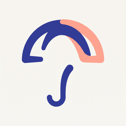

<p align="center"></p>

# Umbrella

One MCP server for your Umbraco 17 site. Umbrella detects which Umbraco products the site has installed and gives your AI tool (Claude Code, VS Code, Cursor, Claude Desktop) the tools for exactly those products.

| Package | Where it runs | What it does |
|---|---|---|
| [`Umbraco.Community.Umbrella`](https://www.nuget.org/packages/Umbraco.Community.Umbrella) (NuGet) | In your Umbraco site | Detects installed products, serves `GET /umbraco/management/api/v1/mcp/capabilities`, adds **MCP** health checks, and the **Umbrella** dashboard with the config for each AI tool |
| [`umbrella-mcp`](https://www.npmjs.com/package/umbrella-mcp) (npm) | On your machine, started by your AI tool | Stdio MCP server: CMS tools always, Forms, Automate and Engage tools when the site has them. Tools are prefixed `cms--`, `forms--`, `automate--`, `engage--`; `get-mcp-health` explains what loaded and why |

The site only needs the NuGet package, but installing it doesn't connect your AI tool. Each person connects their own: create an API user, copy the config from Settings → **Umbrella** → **Overview** into the AI tool, and supply the client secret ([Get started](#get-started)). The AI tool then starts `umbrella-mcp` with `npx`, which downloads it the first time.

> This is Umbrella's public home: the documentation below and the [issue tracker](https://github.com/MarcusK00/Umbrella-Issues/issues). The source code is not public. To report a bug or ask a question, see [Report a problem](#report-a-problem).

## Contents

- [How it works](#how-it-works)
- [Get started](#get-started)
- [Teams, editors and hosted sites](#teams-editors-and-hosted-sites)
- [Configuration](#configuration)
- [Tool permissions](#tool-permissions)
- [Health checks](#health-checks)
- [Troubleshooting](#troubleshooting)
- [Compatibility](#compatibility)
- [Known limitations](#known-limitations)
- [Report a problem](#report-a-problem)

## How it works

1. The add-on finds each product by its assembly and checks that its Management API is live.
2. When your AI tool starts `umbrella-mcp`, the server signs in as an Umbraco API user and asks the site which products it has.
3. It loads the CMS tools, plus the tools of every detected product, and prefixes each tool with its product (`forms--list-forms`).
4. The server's MCP `instructions` tell the agent which prefix to use for which kind of request, and every tool description starts with its product, for example `[Umbraco Forms] …`.

Without the add-on, the server still starts, with CMS tools only.

## Get started

You need Umbraco 17, and Node.js 22 or later on the machine that runs your AI tool.

1. **Install the add-on** in your site and restart it:

   ```bash
   dotnet add package Umbraco.Community.Umbrella
   ```

2. **Create an API user** in the backoffice (Users → Create → API user) and add client credentials with a client id and a secret of your choice, for example `umbraco-back-office-mcp`. Keep a copy of the secret: Umbraco stores only its hash. Give the user's groups access to the sections of the products you want the AI to use (Content, Media, Settings, Forms, Automate, Engage, …). Each person who uses an AI tool with the site gets an API user of their own: see [Teams, editors and hosted sites](#teams-editors-and-hosted-sites).

3. **Copy the config for your AI tool.** In the backoffice, open Settings → **Umbrella** → **Overview** → **Connect an AI tool** (click **Show steps** if it is closed), pick the API user to sign in as, and pick your AI tool. The panel then shows the config to copy, where it goes, how to supply the secret, and what to do next:

   | AI tool | Where it goes |
   |---|---|
   | Claude Code | `.mcp.json` in the folder you open in Claude Code |
   | Claude Code (command) | a `claude mcp add` command to run in that folder; Claude Code keeps it in your own settings |
   | Claude Desktop | `claude_desktop_config.json` (Claude Desktop: Settings → Developer → Edit Config) |
   | VS Code | `.vscode/mcp.json` |
   | Cursor | `.cursor/mcp.json` |
   | Other clients | the generic `mcpServers` config |

   The config is filled in with the address you opened the backoffice on and the API user's client id.

4. **Supply the secret.** The config never contains the secret, only a way to supply it:
   - **VS Code** asks for it when the server starts.
   - **Claude Code (`.mcp.json`) and Cursor** read it from the `UMBRELLA_CLIENT_SECRET` environment variable.
   - **The `claude mcp add` command, Claude Desktop and other clients** have a placeholder: replace it with the secret. That config then contains the secret, so keep it out of source control.

   To set the environment variable on macOS / Linux (add it to your shell profile to keep it):

   ```bash
   export UMBRELLA_CLIENT_SECRET="<the client secret>"
   ```

   Windows (PowerShell; applies to programs you start afterwards):

   ```powershell
   setx UMBRELLA_CLIENT_SECRET "<the client secret>"
   ```

   Restart your AI tool afterwards: it only sees variables that were set before it started.

5. **Start it.** Restart or reload your AI tool and approve the `umbraco` server when it asks. `npx` downloads and starts `umbrella-mcp`.

6. **Check it works.** Ask the AI to call `get-mcp-health`. It sums up what the API user can use, and lists each product, whether its tools loaded, and how many. In the backoffice, Settings → **Umbrella** → **Overview** shows the API user the server connected as, whether it can reach each product, and what to fix if not.

### The config

Every tab on the Overview is a variant of this config:

```json
{
  "mcpServers": {
    "umbraco": {
      "command": "npx",
      "args": ["-y", "umbrella-mcp@17.0.0-alpha.8"],
      "env": {
        "UMBRACO_BASE_URL": "https://your-site",
        "UMBRACO_CLIENT_ID": "umbraco-back-office-mcp",
        "UMBRACO_CLIENT_SECRET": "<your client secret>"
      }
    }
  }
}
```

- **Version:** the config pins `umbrella-mcp` to the add-on's version: the two packages are released together with the same version number. After upgrading the add-on, change the version in your config; the Overview, the "MCP client setup" check and `get-mcp-health` say when they differ.
- **HTTPS:** `UMBRACO_BASE_URL` must be `https://`, because the Management API token endpoint rejects plain HTTP. Open the backoffice over HTTPS to get the right address in the config.
- **Local sites:** for a site on `localhost` the config sets `NODE_TLS_REJECT_UNAUTHORIZED=0`, because Node does not trust the ASP.NET Core development certificate. This turns off certificate checks for the MCP server process only, and only when the site is on the local machine.

## Teams, editors and hosted sites

Give each person who connects an AI tool their own API user:

- **Why one each:** the Overview's **Access per API user** table shows each API user that connected, and [Tool Permissions](#different-settings-per-api-user) can give each one their own settings. People who share an API user share its settings and show up as one user.
- **Setting someone up:** create their API user with its own client id, and give its groups the sections they need. On Settings → **Umbrella** → **Overview** → **Connect an AI tool**, click **Show steps**, pick that user, copy the config for their AI tool, and send it to them. Send the client secret separately.
- **Editors:** an editor doesn't need the site's source code. They need Node.js 22 or later and an AI tool, for example Claude Desktop. The Umbrella dashboard is in the Settings section, so someone with access to it sets them up.
- **Hosted sites, such as Umbraco Cloud:** the MCP server runs on each person's machine and connects to the site over HTTPS, so it works with any environment. Open the dashboard on the environment the AI tools should use, so the config gets its address. Tool settings and the connection list are stored in that environment's database, so each environment has its own; create the API users on the environment the AI tools connect to.
- **Shared repositories:** a `.mcp.json` committed to a repository holds one client id, so everyone who uses it signs in as the same API user. Use the `claude mcp add` command instead, which Claude Code keeps in each person's own settings, or keep `.mcp.json` out of the repository.

Tool settings are guardrails, not access control: see [Known limitations](#known-limitations).

## Configuration

### Site (`appsettings.json`)

| Setting | Default | Meaning |
|---|---|---|
| `Umbraco:Mcp:ClientId` | `umbraco-back-office-mcp` | The client id the config on Settings → Umbrella → Overview starts with when no API user is picked yet. The "MCP API user" check does not use it: it reports on whichever API user the MCP server connected as |

### MCP server (environment variables)

| Variable | Meaning |
|---|---|
| `UMBRACO_BASE_URL`, `UMBRACO_CLIENT_ID`, `UMBRACO_CLIENT_SECRET` | The site (`https://`) and the API user to sign in as. Required: the server exits without them |
| `UMBRACO_MCP_MODULES` | Force modules on without detection, for example `forms,automate` |
| `UMBRACO_TOOL_MODES`, `UMBRACO_INCLUDE_/EXCLUDE_TOOL_COLLECTIONS`, `UMBRACO_INCLUDE_/EXCLUDE_TOOLS` | Toolkit filters. Unprefixed entries apply to CMS; `forms:<value>` targets a module; `forms:*` means no restriction for that module. In the two `*_TOOLS` lists you can also use the visible name, for example `cms--delete-document` or `forms--list-forms`. Collection filters set here for a product override the [Umbrella dashboard's tool groups](#tool-permissions) for that product |
| `UMBRACO_READONLY` | `true` registers only read-only tools, for every module. To do this for one product, use the Umbrella dashboard |
| `UMBRACO_NO_DESTRUCTIVE` | `true` leaves out the destructive tools, for every module. To do this for one product, use the Umbrella dashboard |
| `UMBRACO_INCLUDE_SLICES`, `UMBRACO_EXCLUDE_SLICES` | Apply to every module |

Filters match the products' own tool names, before the prefix is added. For example, to keep only the CMS `document` and `media` tool groups, and the Forms tools (as set on the dashboard) except deleting forms:

```json
"env": {
  "UMBRACO_INCLUDE_TOOL_COLLECTIONS": "document,media",
  "UMBRACO_EXCLUDE_TOOLS": "forms--delete-form"
}
```

The command `npx -y umbrella-mcp@<version> --list-tools`, run with the same environment variables, prints the tool names the server would register and exits.

## Tool permissions

Settings → **Umbrella** → **Tool Permissions** sets which tools the MCP server exposes. On the left you pick whose settings you edit: **Defaults** (every API user) or one API user. On the right, each product the site has installed has a card with an **access** setting, four steps from least to most:

- **Off:** the MCP server doesn't load the product at all. Your AI tool sees none of its tools, and the server's instructions don't mention it. `get-mcp-health` notes that it was switched off in the backoffice. Umbraco CMS can't be switched off, because the MCP server signs in through it.
- **Read-only:** only tools marked read-only (the ones that list and fetch), so the AI can look at that product but not change it.
- **No deletes:** leaves out the tools the product marks as destructive (`destructiveHint`), so the AI can create and edit but not delete. That is mostly deletes, emptying recycle bins and terminating runs, plus removing and disconnecting Automate steps, Automate version rollback, running a Forms record action, and a few Engage switches and permission changes. Unpublishing, moving to the recycle bin, and CMS and Forms version rollback are not flagged, so they stay available.
- **Full:** every tool in the groups that are switched on, the default.

Under the access setting, a bar shows how many of the product's tools the AI tool gets, for example **242 of 375 tools**. **Tool groups: X of Y switched on** opens one switch per tool group (for example Umbraco Forms → **Prevalue source**). Switch a group off to stop exposing its tools. Fewer tools means less context for the AI and better tool choice. Each group shows how many tools stay at the chosen access, for example `6 of 14`. A product with many groups gets a filter, and **Switch all on** / **Switch all off** apply to the groups shown.

- **Unsaved changes:** while the page differs from what is saved, the footer at the bottom says **Unsaved changes** with **Discard changes** and **Save**. Changing something back makes the page clean again. Leaving with unsaved changes (another tab, another API user, another part of the backoffice) asks first; closing or reloading the browser tab gets the browser's own prompt.
- **On by default:** every group starts ticked. Untick the ones you don't want; once you save a product, the saved list is used from then on.
- **When it applies:** the next time the MCP server starts. Reconnect it in your AI tool after saving.
- **Before the first start:** Tool Permissions has no tool groups until an MCP server has started once, because the server reports its tool groups when it starts.
- **Environment wins for groups:** if the MCP server's environment sets `UMBRACO_INCLUDE_TOOL_COLLECTIONS` or `UMBRACO_EXCLUDE_TOOL_COLLECTIONS` for a product (including `forms:*`, or an unprefixed entry for CMS), the group settings are ignored for that product and the card says so. So `forms:*` brings back every Forms group switched off in the dashboard, and an exclude filter such as `UMBRACO_EXCLUDE_TOOL_COLLECTIONS=forms:folder` leaves out only the groups it names. An include filter such as `forms:folder` keeps only the groups it names. `UMBRACO_INCLUDE_TOOLS` also still includes a tool from a switched-off group.
- **The access setting always applies:** it only removes tools, so the environment can't undo it, and it applies even when environment collection filters make the group settings ignored. A product switched off stays off even when `UMBRACO_MCP_MODULES` forces it on. `UMBRACO_READONLY=true` makes every product read-only and `UMBRACO_NO_DESTRUCTIVE=true` removes destructive tools from every product, whatever the dashboard says.
- **If the site can't be read:** when the MCP server can't read the site's settings it can't apply the dashboard's access settings, so set `UMBRACO_NO_DESTRUCTIVE=true` (or `UMBRACO_READONLY=true`) in the AI tool's config to enforce it regardless.
- **Older servers:** an MCP server from before the No deletes step ignores it, and one from before Off loads the product anyway. The version notes on the Overview and in `get-mcp-health` flag a server that isn't the add-on's version. When the last report has no counts for No deletes, the card warns that the MCP server still includes destructive tools.
- **Not a security control:** anyone with the API user's credentials can call the Management API directly. Use the API user's groups and sections to limit what it can do.

The settings and the reported tool groups are stored in the `umbracoKeyValue` table, so they survive restarts and are shared by every server of a load-balanced site. Changing them needs access to the Settings section.

### Different settings per API user

When each developer has their own API user, the tool settings can differ per user. The list on the left starts on **Defaults**: the settings you see and save there are the defaults every API user follows. Pick one API user to give it its own settings. Users with their own settings show how many products they have their own settings for, for example **2 own**.

- **Customise:** for a single API user, a product that follows the defaults is shown as a one-line summary with a **Follows defaults** tag and a **Customise for {name}** button. Customising starts that user's own access and groups for the product from a copy of the current defaults, tagged **Own settings**, and says when its access differs from the defaults. **Use the defaults** drops them again, and **Use the defaults for everything** at the top drops all of that user's own settings. Saving stores the customised products as that user's own settings; the others keep following the defaults, also when you change the defaults later.
- **No section access:** for a single API user, a product whose section none of its user groups grant isn't listed: its MCP server doesn't load that product, whatever the access says. The Overview's access table shows it as **No access**. Grant the section to one of its groups in Users to give it access.
- **Per product, all or nothing:** an own setting holds a product's groups and access together. A user can't follow the default groups with its own access.
- **Any API user:** every API user on the site can be picked, also one that has never connected, so you can set up a new developer before their first start. Under a default, the card names the users that have their own settings for that product.
- **When it applies:** the next time that user's MCP server starts, so they reconnect it in their AI tool. `get-mcp-health` says when the settings are the user's own ("for this API user").
- **Counts:** for a single API user, the tool counts come from that user's own last start. A user whose MCP server hasn't started yet shows its groups and access without counts until it has, because the counts depend on each API user's permissions (the CMS tools in particular). A product that was off for the user isn't in its last report, so its groups come from the defaults until the user's server starts with it on. Under **Defaults**, each group shows the highest count any API user's MCP server reported.
- **Overview:** Settings → Umbrella → **Overview** starts with a status banner: **Everything is working**, **Ready to connect**, or how many things need attention, grouped by products, MCP server and API users, with notes such as an older `umbrella-mcp` (one line per version, naming its users) behind an info toggle, with the add-on and `umbrella-mcp` versions and the last connection. **Access per API user** is a table with a column per product: the first row is the defaults, then each connected API user by name, and per product its access and the number of tools its last start got (a dot marks the user's own settings), the total, and **No access** (no tools, not counted in the total) when its groups don't grant a product's section. Each column header shows the product's version. **Edit defaults** and **Edit permissions** open Tool Permissions with the defaults or that user picked; **⋯** shows the user's client id, when it last connected and its `umbrella-mcp` version, with **Forget connection**. A product that is installed but that an API user's MCP server didn't load at its last start (although it is on for that user and the user has its section) is a warning under products; ask the AI to call `get-mcp-health` for the reason.

## Health checks

Settings → Health Check → **MCP** has three checks:

- **MCP products**: which Umbraco products the add-on detected, their versions, whether their Management APIs are available, and whether the connected MCP servers loaded them.
- **MCP API user**: every API user the MCP server has connected as, whatever its name or client id: when it last connected, whether it can still sign in, and which detected products its sections reach. A missing section is shown as a note, not a warning: an API user for content only doesn't need Automate or Engage. Its MCP server doesn't load those products, and `get-mcp-health` says so. The MCP server connects once when your AI tool starts it, so until then the check only says no MCP server has connected yet. A stdio MCP server has no lasting connection, so the check shows the last connection, not whether one is open right now. Connections are stored in the `umbracoKeyValue` table.
- **MCP client setup**: whether each connected API user's MCP server is the add-on's version.

The checks show short rows with the same findings as Settings → Umbrella → Overview, which has the details and the config to copy. The "MCP client setup" description points there, once for the whole group.

In your AI tool, the `get-mcp-health` tool shows what the server loaded and why: the add-on's status, the Umbraco version check, each product with its tool count and issues, and notes on what to fix, including when the server is not the add-on's version.

## Troubleshooting

Start with `get-mcp-health` in your AI tool and the **MCP** health checks in the backoffice. They cover most of the cases below.

If none of this explains it, [open an issue](https://github.com/MarcusK00/Umbrella-Issues/issues/new/choose) with the add-on and `umbrella-mcp` versions and the `get-mcp-health` output. Report security vulnerabilities privately, see the tracker's [security policy](https://github.com/MarcusK00/Umbrella-Issues/blob/main/SECURITY.md).

| Symptom | Likely cause | Fix |
|---|---|---|
| The server exits with `Could not authenticate against Umbraco` | Wrong URL, client id or secret; the API user is disabled; or `UMBRACO_BASE_URL` is `http://` | Check the three `UMBRACO_*` values. The URL must be `https://`. The "MCP API user" check shows whether the user can still sign in |
| Authentication fails although the secret is right, or the server exits with `Error: UMBRACO_CLIENT_SECRET is required.` | `UMBRELLA_CLIENT_SECRET` was not set when your AI tool started, so the server received the literal text `${UMBRELLA_CLIENT_SECRET}`, or nothing | Set the variable, then restart the AI tool (not just the MCP server) |
| The Overview's config has the wrong client id | The API user picker is on another user, or no API user has a client id yet | Pick the API user under **Connect an AI tool**. Only API users with client credentials are listed |
| The server exits with `Error: UMBRACO_BASE_URL is required.` (or another variable) | The MCP client config has no `env` entry for it | Use the config from Settings → Umbrella → Overview |
| TLS errors such as `self-signed certificate` | Node does not trust the site's certificate. The config from the Overview only turns checks off for `localhost` | Trust the certificate with `NODE_EXTRA_CA_CERTS=<path to the .pem>`, or for a local development host only, add `NODE_TLS_REJECT_UNAUTHORIZED=0` to `env` |
| Only `cms--` tools are listed | The add-on is not installed or not reachable, or a product is not installed, not enabled, or not on major version 17 | `get-mcp-health` gives the reason per product. "MCP products" in the backoffice shows what the site detected |
| One product's tools are missing although it is installed | It is switched **Off** in Settings → Umbrella → Tool Permissions, in the defaults or for this API user | `get-mcp-health` notes "Switched off in the backoffice". Set its access to another step and reconnect |
| A product's tools are missing, and `get-mcp-health` says the user groups don't grant its section | The API user's groups don't grant that product's section, so the MCP server leaves it out | If the user should have it, grant the section to one of its groups and reconnect. The "MCP API user" check names the section |
| "MCP client setup", the dashboard or `get-mcp-health` says the versions differ | Your AI tool's config still pins the `umbrella-mcp` of an earlier add-on | Set `umbrella-mcp@<add-on version>` in the config |
| Tool Permissions shows "No tool groups reported yet" | No MCP server has started against this site yet | Start it once from your AI tool, then reload the dashboard. If it stays empty, `get-mcp-health` notes why the tool groups could not be reported |
| Dashboard changes have no effect | The server reads the settings when it starts, or the environment sets collection filters for that product | Reconnect the MCP server. The dashboard warns when the environment overrides it |

## Compatibility

| Component | Version |
|---|---|
| Umbraco CMS | 17.x (.NET 10) |
| Node.js | 22 or later |
| Umbraco Forms, Umbraco Automate, Umbraco Engage | 17.x |
| `@umbraco-cms/mcp-server-sdk` | 1.0.0-beta.47 (one copy shared by all products) |
| `@umbraco-cms/mcp-dev` | 17.6.12 |
| `@umbraco-forms/mcp-dev` | 17.6.1-beta.6 |
| `@umbraco-automate/mcp-dev` | 17.4.0-beta.5 |
| `@umbraco-engage/mcp-dev` | 17.0.0-beta.5 |

## Known limitations

- Tool names are prefixed (`cms--get-document`), so they differ from the standalone CMS MCP's names.
- Tool settings, per API user or for everyone, are guardrails applied by the MCP server on each developer's machine, not access control. Anyone with an API user's credentials can call the Management API directly, so the API user's Umbraco permissions (groups and sections) are the boundary.
- Only `--list-tools` is supported as a CLI flag; `--describe-tool` is not implemented.
- Collection filters do not pull in dependent collections (for example `media` does not add `temporary-file`) the way the standalone CMS MCP does.

## Report a problem

1. Run `get-mcp-health` in your AI tool, and look at Settings → **Umbrella** → **Overview** and the **MCP** health checks in the backoffice. [Troubleshooting](#troubleshooting) covers the common cases.
2. Search the [open and closed issues](https://github.com/MarcusK00/Umbrella-Issues/issues?q=is%3Aissue).
3. [Open an issue](https://github.com/MarcusK00/Umbrella-Issues/issues/new/choose) and pick a form: bug report, feature request or question. For a bug, include the add-on and `umbrella-mcp` versions and the `get-mcp-health` output.

Issues are public. Before you post, remove client secrets, API keys, site URLs you don't want public, and personal data (names, emails, member or form entry data).

**Security vulnerabilities:** don't open an issue. Report them privately, see [SECURITY.md](SECURITY.md).

Umbrella is a community project, not an official Umbraco HQ package. Problems with Umbraco CMS, Forms, Automate or Engage themselves belong in those products' channels; if you're not sure which it is, open an issue here.

## License

[MIT](LICENSE)
